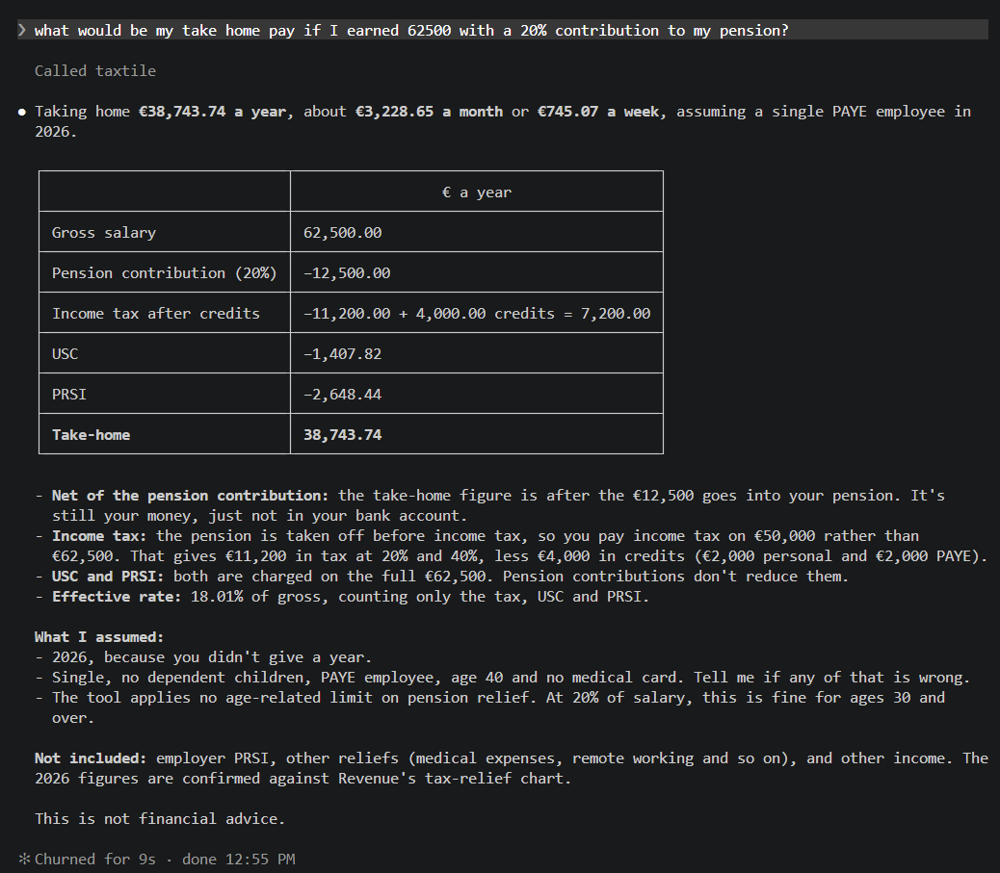

# Taxtile: Irish tax calculator for Claude

Ask Claude about Irish tax and get exact figures instead of guesses. Taxtile gives Claude Code a calculator for income tax (PAYE), USC, PRSI, capital gains tax, tax credits and take-home pay, for tax years 2018 to 2027, plus a skill that tells Claude when to use it, what to ask you, and what to caveat.

```
/plugin marketplace add AranBSmith/taxtile
/plugin install taxtile@taxtile-marketplace
```

Needs [Claude Code](https://claude.com/claude-code) and Node 20 or later. It runs locally and sends nothing over the network.

## Example



Claude calls the Taxtile tool, answers from its result, and says what it assumed and what the figures leave out.

More things to ask:

- "I'm married, jointly assessed, I earn 70,000 and my partner 30,000. What do we pay in 2025?"
- "Compare 80,000 with and without a 10% pension contribution."
- "I sold shares for a 20,000 gain in 2026. What is the CGT?"
- "What are the USC bands for 2026?"
- "I'm a widow with two children, three years after my husband died. What credits do I get?"

## What it covers

- Income tax (PAYE or self-employed), USC, PRSI and CGT, with credits, benefit in kind, pension contributions, Rent-a-Room and the rent tax credit.
- Single, married (jointly assessed or not) and widowed people, including the Home Carer credit, the Single Person Child Carer credit and the Widowed Parent credit.
- Comparing scenarios side by side, and looking up the rates, bands and credits for any supported year.
- Every result says which tax year figures are confirmed, provisional (Budget coverage) or unverified, what is not modelled, and links to Revenue's pages so you can check it.

It does not replace Revenue or a tax adviser. See the disclaimer in [plugin/README.md](plugin/README.md).

## How it works

The calculation is ordinary code, not the model's memory, so the same input always gives the same answer. Claude works out which tool to call and with what inputs, asks you for anything missing, and reports the result. The same calculation powers the web calculator at https://taxtile.surge.sh.

See [plugin/README.md](plugin/README.md) for usage and troubleshooting.

## Found a wrong result?

[Open an issue](../../issues/new/choose) with the inputs and the answer you expected, ideally with a link to the Revenue page that says so.

## Licence

MIT, see [LICENSE](LICENSE). Bundled dependencies and their licences are listed in [THIRD_PARTY_NOTICES.md](THIRD_PARTY_NOTICES.md).

## Releases

Versions are managed by [Release Please](https://github.com/googleapis/release-please) from [Conventional Commits](https://www.conventionalcommits.org): `fix:` and `docs:` bump the patch, `feat:` the minor, `feat!:` or a `BREAKING CHANGE:` footer the major (minor while below 1.0). `ci:`, `test:`, `build:` and `chore:` commits are hidden and do not trigger a release. Merging the release PR bumps `plugin/.claude-plugin/plugin.json`, updates `CHANGELOG.md` and tags the release. Installed users only get updates on a version bump.
